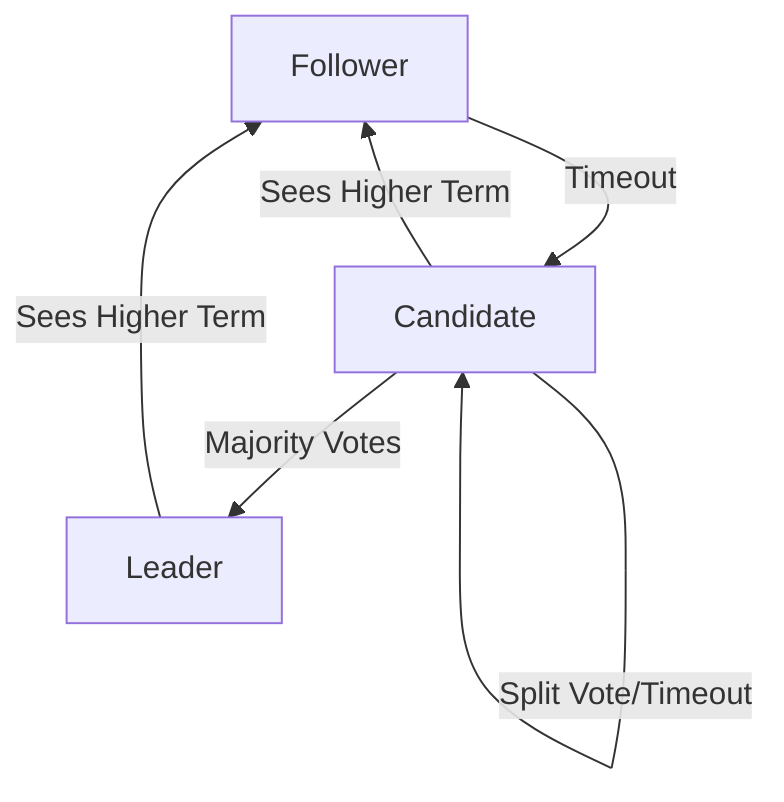

# Replication And Consistency
## Leader-Based, Leaderless, Quorums и Consensus (Raft/Paxos)

---

## 📋 Prerequisites

Перед началом этого модуля вы должны:

- **CAP Theorem**: Понимать компромисс между CP и AP.

- **Failures**: Знать, что узлы падают.

- **Latency**: Понимать, что свет не мгновенен.

---

## 🎯 Learning Objectives

После завершения этого модуля вы сможете:

- **Architectures**: Выбирать между Single-Leader (MySQL), Multi-Leader (Google Docs) и Leaderless (Cassandra).

- **Quorums**: Рассчитывать параметры $N, R, W$ для достижения строгой согласованности.

- **Consensus**: Объяснять алгоритм Raft (Leader Election, Log Replication).

- **Practice**: Написать симулятор выборов лидера (Raft Election) на Python.

- **Troubleshooting**: Диагностировать Replication Lag и понимать его последствия ("Stale Read").

---

## 1. Зачем нужна репликация?

Репликация — это создание и поддержание копий данных на нескольких узлах. Это фундаментальная техника для построения надежных и масштабируемых систем.

### 1.1 Основные причины

1.  **High Availability**: Если один сервер сгорел, второй продолжает работать.
2.  **Latency**: Держите копию данных в Лондоне для британцев и в Нью-Йорке для американцев.
3.  **Scalability**: Чтение можно размазать по 100 читающим репликам.

### 1.2 Пример: Репликация в PostgreSQL

```python
# Пример настройки репликации в PostgreSQL
# На Master (Primary):
# postgresql.conf:
# wal_level = replica
# max_wal_senders = 3
# archive_mode = on

# pg_hba.conf:
# host replication replica_user 192.168.1.0/24 md5

# На Replica (Standby):
# recovery.conf (PostgreSQL < 12) или postgresql.auto.conf (PostgreSQL >= 12):
# primary_conninfo = 'host=master.example.com port=5432 user=replica_user'
# restore_command = 'cp /var/lib/postgresql/archive/%f %p'

# Проверка статуса репликации:
# SELECT * FROM pg_stat_replication;
```

**Output:**
```
pid  | usesysid | usename  | application_name | client_addr | state   | sync_state

-----+----------+----------+------------------+-------------+---------+------------
1234 | 16384    | replica  | walreceiver      | 192.168.1.5 | streaming | async
```

### 1.3 Метрики репликации

```python
# Мониторинг задержки репликации

import psycopg2
import time

def check_replication_lag(primary_conn, replica_conn):
    """Проверяет задержку репликации между Primary и Replica."""
    
    # На Primary: получаем текущую позицию WAL
    with primary_conn.cursor() as cur:
        cur.execute("SELECT pg_current_wal_lsn()")
        primary_lsn = cur.fetchone()[0]
    
    # На Replica: получаем последнюю примененную позицию
    with replica_conn.cursor() as cur:
        cur.execute("SELECT pg_last_wal_replay_lsn()")
        replica_lsn = cur.fetchone()[0]
    
    # Вычисляем разницу в байтах
    with primary_conn.cursor() as cur:
        cur.execute("SELECT pg_wal_lsn_diff(%s, %s)", (primary_lsn, replica_lsn))
        lag_bytes = cur.fetchone()[0]
    
    return lag_bytes

# Использование

primary = psycopg2.connect("host=master dbname=app user=monitor")
replica = psycopg2.connect("host=replica dbname=app user=monitor")

lag = check_replication_lag(primary, replica)
print(f"Replication lag: {lag / 1024 / 1024:.2f} MB")
```

**Объяснение:**

- `pg_current_wal_lsn()` возвращает текущую позицию записи в WAL на Primary
- `pg_last_wal_replay_lsn()` возвращает последнюю примененную позицию на Replica
- `pg_wal_lsn_diff()` вычисляет разницу между двумя позициями
- Задержка измеряется в байтах WAL, которые еще не применены на Replica

---

## 2. Архитектуры репликации

Существует три фундаментальных подхода.

### 2.1 Single-Leader (Master-Slave)

Самый популярный (PostgreSQL, MySQL, Kafka partition).

*   **Write**: Все записи идут только в **Leader**.

*   **Read**: Читать можно с Leader или Follower.

*   **Replication**: Leader шлет поток изменений (Replication Log) фолловерам.

**Типы**:
*   **Sync**: Лидер ждет подтверждения от слейва. (Safe, но Slow). Если слейв упал, запись встала.

*   **Async**: Лидер записал и ответил "ОК". Слейв догонит потом. (Fast, но Unsafe). Если лидер умер до репликации, данные потеряны.

*   **Semi-Sync**: Ждем хотя бы одного слейва (компромисс).

**Пример: MySQL Replication Configuration**

```sql
-- На Master:
-- my.cnf:
-- [mysqld]
-- server-id = 1
-- log-bin = mysql-bin
-- binlog-format = ROW

-- Создание пользователя для репликации:
CREATE USER 'replica'@'%' IDENTIFIED BY 'password';
GRANT REPLICATION SLAVE ON *.* TO 'replica'@'%';

-- Получение позиции для настройки Replica:
SHOW MASTER STATUS;
-- Output:
-- File: mysql-bin.000001
-- Position: 154
-- Binlog_Do_DB: 
-- Binlog_Ignore_DB: 

-- На Replica:
-- my.cnf:
-- [mysqld]
-- server-id = 2
-- relay-log = mysql-relay-bin
-- read-only = 1

-- Настройка репликации:
CHANGE MASTER TO
  MASTER_HOST='master.example.com',
  MASTER_USER='replica',
  MASTER_PASSWORD='password',
  MASTER_LOG_FILE='mysql-bin.000001',
  MASTER_LOG_POS=154;

START SLAVE;

-- Проверка статуса:
SHOW SLAVE STATUS\G
-- Key fields:
-- Slave_IO_Running: Yes
-- Slave_SQL_Running: Yes
-- Seconds_Behind_Master: 0
```

**Синхронная vs Асинхронная репликация:**

```python
# Симуляция синхронной репликации

import time
import random

class SyncReplication:
    def __init__(self, replicas):
        self.replicas = replicas
    
    def write(self, data):
        """Синхронная запись: ждем подтверждения от всех."""
        print(f"Writing to primary: {data}")
        time.sleep(0.01)  # Запись на диск
        
        # Ждем подтверждения от всех реплик
        for replica in self.replicas:
            if not replica.replicate(data):
                raise Exception(f"Replica {replica.id} failed!")
        
        print("All replicas confirmed. Write committed.")
        return True

class AsyncReplication:
    def __init__(self, replicas):
        self.replicas = replicas
    
    def write(self, data):
        """Асинхронная запись: не ждем подтверждения."""
        print(f"Writing to primary: {data}")
        time.sleep(0.01)  # Запись на диск
        
        # Отправляем в фоне, не ждем
        for replica in self.replicas:
            replica.replicate_async(data)
        
        print("Write committed (replication in background).")
        return True

# Сравнение производительности

sync = SyncReplication([Replica(1), Replica(2), Replica(3)])
async_rep = AsyncReplication([Replica(1), Replica(2), Replica(3)])

# Sync: ~40ms (10ms primary + 3 * 10ms replicas)
# Async: ~10ms (только primary)
```

### 2.2 Multi-Leader (Master-Master)

*   Можно писать в *любой* узел, который является Лидером (обычно по одному на датацентр).
*   **Плюс**: Переживает падение всего ДЦ. Локальная запись (быстро).

*   **Минус**: **Конфликты**.
    *   DC1: `UPDATE user SET name='A'`
    *   DC2: `UPDATE user SET name='B'`
    *   Async replication встречается посередине Атлантики. Кто прав? Нужна логика разрешения конфликтов (Last Write Wins, CRDT).

### 2.3 Leaderless (Dynamo-style)

Все узлы равны. (Cassandra, Riak, DynamoDB).

*   Клиент шлет запись сразу на $N$ узлов.
*   Клиент считает запись успешной, если $W$ узлов ответили "ОК".
*   Никакого failover! Если узел упал, мы просто пишем на соседние.

---

## 3. Quorums (Математика большинства)

В Leaderless системах гарантия консистенции определяется формулой:
$$R + W > N$$

*   $N$: Количество реплик (Replication Factor).
*   $W$: Write Quorum (сколько узлов должны подтвердить запись).
*   $R$: Read Quorum (сколько узлов мы опрашиваем при чтении).

**Доказательство**:
Если $W+R > N$, то множество узлов записи и множество узлов чтения гарантированно пересекаются хотя бы в одном узле.
Этот узел вернет самую свежую версию.

**Примеры (N=3)**:
1.  **Strong Consistency**: $W=2, R=2$. ($2+2=4 > 3$). Читаем с кворумом, пишем с кворумом. Медленно, но надежно.
2.  **Write Heavy**: $W=1, R=3$. Пишем мгновенно (в любой). Читаем долго (опрашиваем всех, чтобы найти свежее).
3.  **Read Heavy**: $W=3, R=1$. Пишем долго (во всех). Читаем мгновенно (с любого, так как все обновлены).
4.  **Sloppy Quorum (Eventual)**: $W=1, R=1$. Быстро, но можно прочитать старье.

**Реализация Quorum Read/Write:**

```python
class QuorumStore:
    """Упрощенная реализация Quorum-based хранилища."""
    
    def __init__(self, nodes, n, w, r):
        self.nodes = nodes  # Список узлов
        self.n = n  # Replication Factor
        self.w = w  # Write Quorum
        self.r = r  # Read Quorum
        assert w + r > n, "Quorum condition violated!"
    
    def write(self, key, value):
        """Запись с кворумом W."""
        responses = []
        for node in self.nodes[:self.n]:
            try:
                node.set(key, value)
                responses.append(True)
            except Exception as e:
                responses.append(False)
        
        if sum(responses) >= self.w:
            return True
        else:
            raise Exception("Write quorum not reached")
    
    def read(self, key):
        """Чтение с кворумом R."""
        values = []
        timestamps = []
        
        for node in self.nodes[:self.n]:
            try:
                result = node.get(key)
                if result:
                    values.append(result['value'])
                    timestamps.append(result['timestamp'])
            except Exception as e:
                continue
        
        if len(values) < self.r:
            raise Exception("Read quorum not reached")
        
        # Возвращаем значение с максимальным timestamp (самое свежее)
        max_idx = timestamps.index(max(timestamps))
        return values[max_idx]

# Пример использования

nodes = [Node(1), Node(2), Node(3)]
store = QuorumStore(nodes, n=3, w=2, r=2)  # Strong Consistency

store.write("user:123", {"name": "Alice", "timestamp": time.time()})
value = store.read("user:123")
```

**Визуализация Quorum:**

```python
# Демонстрация пересечения множеств

def visualize_quorum(n, w, r):
    """Показывает, почему R+W>N гарантирует консистентность."""
    nodes = list(range(1, n+1))
    
    # Write quorum: случайные W узлов
    write_nodes = set(random.sample(nodes, w))
    
    # Read quorum: случайные R узлов
    read_nodes = set(random.sample(nodes, r))
    
    # Пересечение гарантировано, если R+W>N
    intersection = write_nodes & read_nodes
    
    print(f"N={n}, W={w}, R={r}")
    print(f"Write nodes: {write_nodes}")
    print(f"Read nodes: {read_nodes}")
    print(f"Intersection: {intersection}")
    print(f"R+W={r+w} > N={n}: {r+w > n}")
    print(f"Intersection guaranteed: {len(intersection) > 0}")

# Тест

visualize_quorum(n=3, w=2, r=2)  # Должно быть пересечение
visualize_quorum(n=3, w=1, r=1)  # Может не быть пересечения!
```

---

## 4. Consensus Algorithms: Проблема согласованности

Репликация проста, пока узлы не падают.
Когда Лидер падает, кластер должен выбрать нового. Как договориться, кто новый босс, если сеть ненадежна?
Это задача **Консенсуса**.

### 4.1 Paxos (1989, Leslie Lamport)

Математически идеальный алгоритм. Очень сложный для понимания.

*   Roles: Proposers, Acceptors, Learners.
*   Phases: Prepare, Promise, Accept, Accepted.
*   Проблема: Трудно реализовать правильно (Google Chubby, Zookeeper ZAB используют вариации).

### 4.2 Raft (2013, Ongaro & Ousterhout)

"Консенсус для людей". Разработан специально, чтобы быть понятным.
Используется в Etcd (Kubernetes), Consul, CockroachDB, TiKV.

**Основные концепции Raft**:
1.  **Leader Election**: В любой момент времени есть 0 или 1 лидер.
2.  **Log Replication**: Лидер принимает команды, пишет в лог, реплицирует фолловерам.
3.  **Safety**: Если узел закоммитил запись с индексом X, никакой другой узел не закоммитит другое значение для X.

**Состояния узла**:
*   **Follower**: Слушает лидера. Если не слышит (timeout) — становится Candidate.

*   **Candidate**: Просит голоса (Vote Request). Если получил большинство — становится Leader.

*   **Leader**: Шлет Heartbeats всем, чтобы подавить новые выборы.

**Raft Log Structure:**

```python
class RaftLog:
    """Структура лога Raft."""
    
    def __init__(self):
        self.entries = []  # [(term, index, command), ...]
        self.committed_index = 0
    
    def append(self, term, command):
        """Добавляет новую запись в лог."""
        index = len(self.entries) + 1
        entry = {
            'term': term,
            'index': index,
            'command': command
        }
        self.entries.append(entry)
        return index
    
    def get_entries_after(self, prev_index, prev_term):
        """Возвращает записи после указанного индекса (для репликации)."""
        if prev_index == 0:
            return self.entries
        
        # Проверка согласованности
        if prev_index > len(self.entries):
            return []
        
        if self.entries[prev_index - 1]['term'] != prev_term:
            return []  # Конфликт терминов
        
        return self.entries[prev_index:]
    
    def commit(self, index):
        """Коммитит записи до указанного индекса."""
        if index > self.committed_index:
            self.committed_index = index

# Пример лога

log = RaftLog()
log.append(term=1, command="SET x=1")
log.append(term=1, command="SET y=2")
log.append(term=2, command="SET x=3")  # Новый лидер в Term 2

print(f"Entries: {log.entries}")
print(f"Committed up to: {log.committed_index}")
```

**Leader Election в деталях:**

```python
class RaftElection:
    """Детальная реализация выборов лидера."""
    
    def __init__(self, node_id, all_nodes):
        self.node_id = node_id
        self.all_nodes = all_nodes
        self.current_term = 0
        self.voted_for = None
        self.state = "Follower"
        self.election_timeout = random.uniform(1.5, 3.0)
        self.last_heartbeat = time.time()
    
    def become_candidate(self):
        """Переход в состояние Candidate."""
        self.state = "Candidate"
        self.current_term += 1
        self.voted_for = self.node_id
        self.last_heartbeat = time.time()
        
        print(f"[Node {self.node_id}] Becoming candidate in Term {self.current_term}")
        
        # Запрашиваем голоса
        votes = 1  # Голос за себя
        for node in self.all_nodes:
            if node.node_id != self.node_id:
                if node.request_vote(self.current_term, self.node_id):
                    votes += 1
        
        # Проверяем большинство
        majority = (len(self.all_nodes) // 2) + 1
        if votes >= majority:
            self.become_leader()
        else:
            # Split vote - остаемся Candidate, ждем нового таймаута
            print(f"[Node {self.node_id}] Split vote! Only {votes}/{len(self.all_nodes)} votes")
    
    def become_leader(self):
        """Переход в состояние Leader."""
        self.state = "Leader"
        print(f"[Node {self.node_id}] 👑 ELECTED LEADER in Term {self.current_term}")
        self.send_heartbeats()
    
    def request_vote(self, term, candidate_id):
        """Обработка запроса голоса."""
        if term > self.current_term:
            self.current_term = term
            self.state = "Follower"
            self.voted_for = None
        
        if term == self.current_term:
            if self.voted_for is None or self.voted_for == candidate_id:
                self.voted_for = candidate_id
                self.last_heartbeat = time.time()
                return True
        
        return False
```

### Visualizing Raft Election



---

## 5. Модели консистентности

Разные системы предоставляют разные гарантии консистентности. Выбор модели зависит от требований к производительности и надежности.

### 5.1 Strong Consistency (Строгая консистентность)

Все узлы видят одни и те же данные в один момент времени. Достигается через синхронную репликацию или Quorum.

```python
class StrongConsistentStore:
    """Хранилище со строгой консистентностью."""
    
    def __init__(self, nodes):
        self.nodes = nodes
    
    def write(self, key, value):
        """Запись синхронно на все узлы."""
        for node in self.nodes:
            node.set(key, value, sync=True)  # Ждем подтверждения
        return True
    
    def read(self, key):
        """Чтение с любого узла (все синхронизированы)."""
        return self.nodes[0].get(key)  # Все узлы одинаковы
```

**Применение**: Финансовые транзакции, критичные данные.

### 5.2 Eventual Consistency (Финальная консистентность)

Система гарантирует, что если не будет новых записей, все узлы в конечном итоге придут к одному состоянию.

```python
class EventuallyConsistentStore:
    """Хранилище с финальной консистентностью."""
    
    def __init__(self, nodes):
        self.nodes = nodes
    
    def write(self, key, value):
        """Запись асинхронно (не ждем)."""
        for node in self.nodes:
            node.set(key, value, sync=False)  # Фоновая репликация
        return True
    
    def read(self, key):
        """Чтение может вернуть старое значение."""
        # Читаем с ближайшего узла (может быть не синхронизирован)
        return self.nodes[0].get(key)
```

**Применение**: Социальные сети, комментарии, лайки.

### 5.3 Causal Consistency (Причинная консистентность)

Если событие A произошло до события B, то все узлы увидят A перед B.

```python
class CausalConsistentStore:
    """Хранилище с причинной консистентностью."""
    
    def __init__(self, node_id, nodes):
        self.node_id = node_id
        self.nodes = nodes
        self.vector_clock = {nid: 0 for nid in [node_id] + [n.id for n in nodes]}
    
    def write(self, key, value):
        """Запись с векторными часами."""
        self.vector_clock[self.node_id] += 1
        
        entry = {
            'key': key,
            'value': value,
            'vector_clock': self.vector_clock.copy()
        }
        
        for node in self.nodes:
            node.set_with_clock(entry)
    
    def read(self, key):
        """Чтение с учетом векторных часов."""
        results = []
        for node in self.nodes:
            result = node.get(key)
            if result:
                results.append(result)
        
        # Выбираем запись с максимальным векторным временем
        # (нормализованным по причинности)
        return self.select_causally_latest(results)
```

### 5.4 Read-After-Write Consistency

Гарантия, что пользователь сразу видит свои собственные записи.

```python
class ReadAfterWriteStore:
    """Хранилище с Read-After-Write консистентностью."""
    
    def __init__(self, nodes):
        self.nodes = nodes
        self.user_last_write = {}  # user_id -> node_id
    
    def write(self, user_id, key, value):
        """Запись от пользователя."""
        # Записываем на Master
        master = self.nodes[0]
        master.set(key, value)
        
        # Запоминаем, куда писали
        self.user_last_write[user_id] = master.id
        return True
    
    def read(self, user_id, key):
        """Чтение: если это свой запрос, читаем с Master."""
        if user_id in self.user_last_write:
            # Читаем с того же узла, куда писали
            node_id = self.user_last_write[user_id]
            node = next(n for n in self.nodes if n.id == node_id)
            return node.get(key)
        else:
            # Обычное чтение с любого узла
            return self.nodes[0].get(key)
```

---

## 6. Разрешение конфликтов (Conflict Resolution)

В Multi-Leader системах конфликты неизбежны. Нужны стратегии их разрешения.

### 6.1 Last Write Wins (LWW)

Простая стратегия: побеждает запись с более поздним timestamp.

```python
class LastWriteWins:
    """Разрешение конфликтов по последней записи."""
    
    def merge(self, value1, timestamp1, value2, timestamp2):
        """Выбирает значение с более поздним timestamp."""
        if timestamp1 > timestamp2:
            return value1, timestamp1
        else:
            return value2, timestamp2

# Пример конфликта
# Node A: SET x=1 at 10:00:00
# Node B: SET x=2 at 10:00:01
# Результат: x=2 (позже по времени)
```

**Проблема**: Может потерять данные, если две записи произошли почти одновременно.

### 6.2 CRDT (Conflict-Free Replicated Data Types)

Структуры данных, которые автоматически разрешают конфликты.

```python
class CRDTSet:
    """CRDT Set: объединение множеств без конфликтов."""
    
    def __init__(self):
        self.elements = set()
        self.tombstones = set()  # Удаленные элементы
    
    def add(self, element):
        """Добавление элемента."""
        self.elements.add(element)
        if element in self.tombstones:
            self.tombstones.remove(element)
    
    def remove(self, element):
        """Удаление элемента."""
        if element in self.elements:
            self.elements.remove(element)
            self.tombstones.add(element)
    
    def merge(self, other):
        """Объединение с другим CRDT Set."""
        # Объединение элементов
        self.elements |= other.elements
        
        # Объединение удалений
        self.tombstones |= other.tombstones
        
        # Удаляем элементы, которые были удалены
        self.elements -= self.tombstones
    
    def get(self):
        """Получение текущего множества."""
        return self.elements - self.tombstones

# Пример использования

set_a = CRDTSet()
set_a.add("x")
set_a.add("y")

set_b = CRDTSet()
set_b.add("y")
set_b.add("z")
set_b.remove("x")

# Объединение

set_a.merge(set_b)
print(set_a.get())  # {'y', 'z'} - автоматически разрешено!
```

### 6.3 Operational Transformation (OT)

Используется в Google Docs для разрешения конфликтов при одновременном редактировании.

```python
class OperationalTransform:
    """Упрощенная реализация OT."""
    
    def transform_insert(self, op1, op2):
        """Трансформация операции вставки относительно другой."""
        # op1: Insert("hello", pos=5)
        # op2: Insert("world", pos=3)
        
        if op1['pos'] <= op2['pos']:
            # op1 не влияет на op2
            return op1
        else:
            # op1 сдвигается на длину op2
            return {
                'type': 'insert',
                'text': op1['text'],
                'pos': op1['pos'] + len(op2['text'])
            }
    
    def apply(self, document, operation):
        """Применение операции к документу."""
        if operation['type'] == 'insert':
            pos = operation['pos']
            text = operation['text']
            return document[:pos] + text + document[pos:]
        elif operation['type'] == 'delete':
            pos = operation['pos']
            length = operation['length']
            return document[:pos] + document[pos+length:]

# Пример

doc = "Hello world"
op1 = {'type': 'insert', 'text': ' beautiful', 'pos': 5}
op2 = {'type': 'insert', 'text': 'my ', 'pos': 0}

# Применяем op2

doc = OperationalTransform().apply(doc, op2)  # "my Hello world"

# Трансформируем op1 относительно op2

op1_transformed = OperationalTransform().transform_insert(op1, op2)
# op1_transformed: {'type': 'insert', 'text': ' beautiful', 'pos': 8}

# Применяем трансформированную op1

doc = OperationalTransform().apply(doc, op1_transformed)
# Результат: "my Hello beautiful world" - корректно!
```

---

## 7. Практика: Raft Election Simulation (Python)

Напишем упрощенную машину состояний Raft.

```python
import random
import threading
import time

class NodeState:
    FOLLOWER = "Follower"
    CANDIDATE = "Candidate"
    LEADER = "Leader"

class RaftNode:
    def __init__(self, node_id, peers):
        self.id = node_id
        self.peers = peers # List of other RaftNodes
        self.state = NodeState.FOLLOWER
        self.current_term = 0
        self.voted_for = None
        self.votes_received = 0
        
        # Election timer (randomized 150-300ms in real Raft)
        self.election_timeout = random.uniform(1.5, 3.0) 
        self.last_heartbeat = time.time()
        
        self.running = True
        threading.Thread(target=self.run_loop).start()

    def run_loop(self):
        while self.running:
            now = time.time()
            dt = now - self.last_heartbeat
            
            if self.state == NodeState.FOLLOWER:
                if dt > self.election_timeout:
                    print(f"[{self.id}] Timeout! Becoming Candidate.")
                    self.start_election()
            
            elif self.state == NodeState.LEADER:
                self.send_heartbeats()
                time.sleep(0.5) # Heartbeat interval
                
            time.sleep(0.1)

    def start_election(self):
        self.state = NodeState.CANDIDATE
        self.current_term += 1
        self.voted_for = self.id
        self.votes_received = 1 # Vote for self
        self.last_heartbeat = time.time() # Reset timer
        self.election_timeout = random.uniform(1.5, 3.0) # Reset timeout
        
        print(f"[{self.id}] Term {self.current_term}: Requesting votes...")
        for peer in self.peers:
            peer.request_vote(self.current_term, self.id)

    def request_vote(self, term, candidate_id):
        if term > self.current_term:
            self.current_term = term
            self.state = NodeState.FOLLOWER
            self.voted_for = None
            
        if (term == self.current_term and 
            (self.voted_for is None or self.voted_for == candidate_id)):
            self.voted_for = candidate_id
            self.last_heartbeat = time.time() # Reset timer because we heard from a valid candidate
            print(f"[{self.id}] Voted for {candidate_id} in Term {term}")
            
            # Simulate network response
            nodes_map[candidate_id].receive_vote(self.id, term)
            return True
        return False

    def receive_vote(self, voter_id, term):
        if self.state != NodeState.CANDIDATE or term != self.current_term:
            return

        self.votes_received += 1
        print(f"[{self.id}] Got vote from {voter_id}. Total: {self.votes_received}")
        
        # Check Majority
        if self.votes_received > (len(self.peers) + 1) / 2:
            print(f"[{self.id}] 👑 I AM LEADER for Term {self.current_term}!")
            self.state = NodeState.LEADER
            self.send_heartbeats()

    def send_heartbeats(self):
        # print(f"[{self.id}] Sending heartbeats...")
        for peer in self.peers:
            peer.append_entries(self.current_term, self.id)

    def append_entries(self, term, leader_id):
        if term >= self.current_term:
            self.current_term = term
            if self.state != NodeState.FOLLOWER:
                print(f"[{self.id}] Step down. New leader is {leader_id}")
            self.state = NodeState.FOLLOWER
            self.last_heartbeat = time.time() # Reset timer

# Simulation Sandbox

nodes_map = {}
node_ids = ["A", "B", "C", "D", "E"]
nodes = []

# Wire up peers

for nid in node_ids:
    n = RaftNode(nid, [])
    nodes_map[nid] = n
    nodes.append(n)

for n in nodes:
    n.peers = [p for p in nodes if p.id != n.id]

# Let them run...
# One will timeout first and become leader.

time.sleep(10)
for n in nodes: n.running = False
```

---

## 8. Мониторинг и диагностика

### 8.1 Метрики репликации

```python
class ReplicationMonitor:
    """Мониторинг состояния репликации."""
    
    def __init__(self, primary, replicas):
        self.primary = primary
        self.replicas = replicas
    
    def get_replication_status(self):
        """Получает статус всех реплик."""
        status = {
            'primary_lsn': self.primary.get_current_lsn(),
            'replicas': []
        }
        
        for replica in self.replicas:
            replica_lsn = replica.get_last_replay_lsn()
            lag = self.primary.calculate_lag(replica_lsn)
            
            status['replicas'].append({
                'id': replica.id,
                'state': replica.get_state(),
                'lag_bytes': lag,
                'lag_seconds': lag / (1024 * 1024 * 10),  # Предполагаем 10MB/s
                'healthy': lag < 100 * 1024 * 1024  # < 100MB отставание
            })
        
        return status
    
    def check_health(self):
        """Проверка здоровья репликации."""
        status = self.get_replication_status()
        
        unhealthy = [r for r in status['replicas'] if not r['healthy']]
        if unhealthy:
            print(f"⚠️ {len(unhealthy)} unhealthy replicas:")
            for r in unhealthy:
                print(f"  - {r['id']}: {r['lag_bytes']/1024/1024:.2f} MB lag")
        else:
            print("✅ All replicas healthy")
        
        return len(unhealthy) == 0
```

### 8.2 Автоматический failover

```python
class AutoFailover:
    """Автоматическое переключение при падении Primary."""
    
    def __init__(self, nodes):
        self.nodes = nodes
        self.primary = nodes[0]
        self.replicas = nodes[1:]
        self.health_check_interval = 5
    
    def check_primary_health(self):
        """Проверка здоровья Primary."""
        try:
            self.primary.ping(timeout=1)
            return True
        except:
            return False
    
    def promote_replica(self, replica):
        """Повышение Replica до Primary."""
        print(f"🔄 Promoting {replica.id} to Primary")
        replica.promote_to_primary()
        self.primary = replica
        self.replicas = [n for n in self.nodes if n != replica]
    
    def run_monitoring(self):
        """Запуск мониторинга в фоне."""
        while True:
            if not self.check_primary_health():
                print("❌ Primary is down! Initiating failover...")
                
                # Выбираем самую актуальную реплику
                best_replica = max(
                    self.replicas,
                    key=lambda r: r.get_last_replay_lsn()
                )
                
                self.promote_replica(best_replica)
            
            time.sleep(self.health_check_interval)
```

---

## 9. Glossary

*   **Replication Factor (RF)**: Число копий данных. Обычно 3 (одна локально, две в других стойках).

*   **Leader / Primary**: Узел, принимающий записи.

*   **Follower / Slave / Replica**: Узел, копирующий данные с лидера (только чтение).

*   **Split Brain**: Ситуация, когда из-за разрыва сети образуются два Лидера. Raft предотвращает это требованием большинства голосов.

*   **Replication Lag**: Задержка между записью на лидере и появлением данных на фолловере.

*   **Stale Read**: Чтение устаревших данных с отстающего фолловера.

*   **Monotonic Reads**: Гарантия, что если пользователь увидел данные версии X, он никогда не увидит версию старее X (Time travel запрещен).

*   **Read-after-Write Consistency**: Гарантия, что пользователь сразу видит свои собственные записи.

*   **Epoch / Term**: Логический счетчик времени (номер выборов) в алгоритмах консенсуса. Помогает отбрасывать сообщения мертвых лидеров.

*   **WAL (Write Ahead Log)**: Главный источник правды. Репликация — это просто пересылка WAL.

---

## 📚 Appendix A: Troubleshooting Guide

### A.1 Replication Lag is High

**Симптом**: Юзер создал пост, обновил страницу — поста нет.
**Причина**:
1.  **Network Bandwidth**: Лидер генерирует 100MB/s WAL, а канал до слейва — 50MB/s. Слейв никогда не догонит.
2.  **Single Threaded SQL**: В MySQL репликация (до версии 5.7/8.0) была однопоточной. Мастер пишет в 32 потока, слейв применяет в 1.
**Лечение**:
*   Мониторинг `Seconds_Behind_Master` (MySQL) или `pg_stat_replication` (Postgres).
*   Parallel Replication (настройка).
*   Sharding (снижение нагрузки на один узел).

### A.2 Split Brain in Ancient Systems

**Симптом**: В старых системах (MySQL + Heartbeat/DRBD) часто случались сплит-брейны при мигании сети. Оба сервера монтировали диск и корраптили файловую систему.
**Лечение**: STONITH. Если ты потерял связь с соседом — убей его (через IPMI/PDU) перед тем как объявить себя мастером. Современные системы (Etcd, Consul Lock) решают это через кворум.

---

## 📚 Appendix B: Historical Context

### 1988: Viewstamped Replication

Брайан Оки и Барбара Лисков (MIT) придумали Viewstamped Replication. Это было **до** Paxos. Это был алгоритм для репликации логов, очень похожий на Raft. Но мир его не заметил.

### 1989: The Part-Time Parliament (Paxos)

Лесли Лэмпорт написал статью про греческий остров Паксос. Статья была полна юмора и аллегорий про "парламент", "скрижалии". Редакторы отказались печатать. Инженеры не поняли.
Статья пролежала в столе 10 лет. Только в 1998 её опубликовали. Алгоритм был гениальным, но "obscure".

### 2013/2014: Raft

Диего Онгаро в Стэнфорде решил, что хватит терпеть. Paxos слишком сложен для студентов.
Он создал Raft ("Плот", который спасет вас от утопления в сложности).
Они провели эксперимент: студентам объясняли Paxos и Raft. Raft понимали в 3 раза быстрее.

---

## 📚 Appendix C: FAQ

**Q1: Можно ли использовать Raft для передачи больших данных?**
**A**: Нет. Raft реплицирует **лог команд** (метаданные, конфигурацию, мелкие записи). Гнать гигабайты видео через Raft — безумие (все пишется на диск последовательно).
Обычно архитектура такая: Raft хранит карту (где лежат данные), а сами данные лежат в Blob Storage или реплицируются более простым протоколом (Chain Replication).

**Q2: Сколько узлов нужно для кластера?**
**A**: Нечетное число. 3, 5 или 7.
*   3 узла: терпит 1 отказ. (Самый частый выбор).
*   5 узлов: терпит 2 отказа (Позволяет выключить один на maintenance, и все равно пережить аварию второго).
*   2 узла: НЕ РАБОТАЕТ. При падении одного не набрать кворум 2/2.

**Q3: Что будет, если сеть разделится 50/50?**
**A**: Ни одна сторона не наберет большинства (Majoriy). Кластер остановится (будет Unavailable для записи). Это цена CP (Consistency).

**Q4: Kafka использует Paxos или Raft?**
**A**:
*   Раньше: Использовала ZooKeeper (который ZAB ≈ Paxos).
*   Сейчас (KRaft): Перешла на свой Raft-подобный протокол внутри брокеров, чтобы избавиться от ZK.

**Q5: Что такое Witness реплика?**
**A**: Узел, который голосует, но не хранит данные (только заголовки логов). Экономит диск, но помогает набрать кворум. (Есть в Microsoft SQL Server, Cassandra, Etcd).

---

## 💡 Key Takeaways

1.  **Latency vs Consistency**: Выбирайте R+W>N только если данные критичны (деньги). Иначе Eventual.
2.  **Async Replication is Unsafe**: При сбое мастера данные за последнюю секунду могут исчезнуть навсегда.
3.  **Raft is King**: Сегодня это стандарт де-факто для Consensus.

---

## 🚀 Next Steps

**Практика:**

1.  Запустите Python скрипт Raft выше. Вы увидите, как узлы выбирают лидера.
2.  Убейте лидера (остановите его поток).
3.  Посмотрите, как фолловеры через таймаут начнут новые выборы (Term увеличится).

В следующем модуле мы спустимся на уровень ниже и изучим, как эффективно хранить логи на диске. [Distributed Logs And Queues](../12_Distributed_Logs_And_Queues/).


