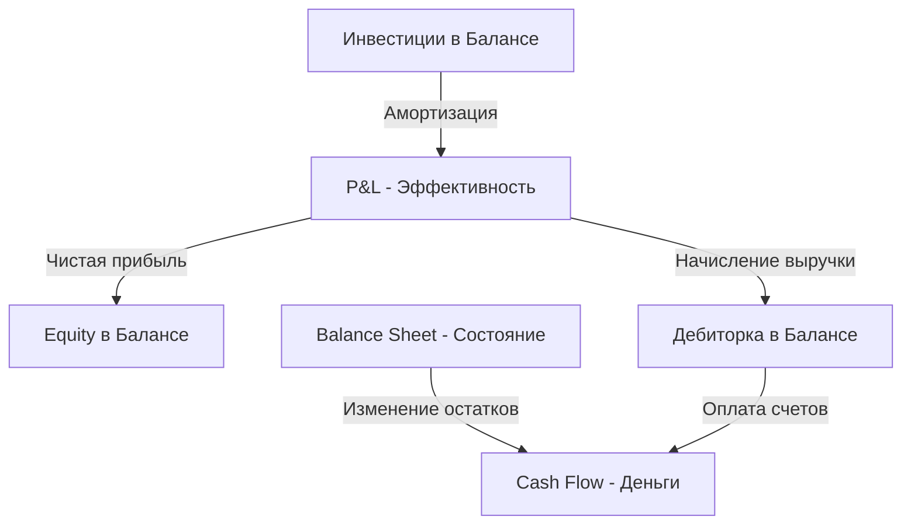

# Основы корпоративных финансов
## Финансовая отчётность (P&L, Cash Flow, Balance Sheet)

---

## 📋 Prerequisites

Перед началом этого модуля вы должны:
- Понимать базовую разницу между доходами и расходами
- Понимать, что такое прибыль компании
- Быть знакомы с основами деятельности сервисной IT-компании

**Recommended prior modules:**
- [Что такое корпоративные финансы](../01_Corporate_Finances/) — базовые понятия доходов, расходов и прибыли

---

## 🎯 Learning Objectives

После завершения этого модуля вы сможете:
- Анализировать структуру и содержание Отчёта о прибылях и убытках (P&L)
- Различать типы денежных потоков в Отчёте о движении денежных средств (Cash Flow)
- Понимать уравнение баланса и структуру активов/пассивов в Balance Sheet
- Объяснять взаимосвязь между тремя основными формами отчётности
- Выделять ключевые отличия управленческой отчётности от бухгалтерской
- Интерпретировать финансовое состояние сервисной IT-компании на основе цифр

---

## 1. Роль финансовой отчётности в бизнесе

Финансовая отчётность — это не просто набор таблиц для налоговой, а **"приборная панель"** управления бизнесом. Без неё менеджмент компании "летит вслепую", не понимая, где он находится и сколько топлива осталось.

### 1.1 Почему одной цифры прибыли недостаточно?

Представьте, что вам сказали: «Компания за месяц заработала $50,000». Это хорошо или плохо? Одной этой цифры мало для принятия решений. Нужно знать:
- Сколько из этого пришло "в кассу", а сколько висит как долг клиента?
- Хватит ли этих денег на зарплаты в следующем месяце?
- Сколько оборудования или долгов стоит за этой прибылью?

Для ответов на эти вопросы используется пакет из трёх взаимосвязанных отчётов:
1. **P&L (Profit and Loss)** — "Как мы поработали?" (Эффективность)
2. **Cash Flow Statement** — "Где деньги?" (Выживаемость)
3. **Balance Sheet** — "Что у нас есть и кому мы должны?" (Устойчивость)

### 1.2 Финансовый год и отчётные периоды

Отчётность обычно формируется за определённые периоды:
- **Месяц** — для оперативного управления
- **Квартал** — для планирования и промежуточного контроля
- **Год** — для оценки глобальной стратегии и выплаты дивиендов

---

## 2. Отчёт о прибылях и убытках (P&L / Profit and Loss)

Это самый популярный отчёт среди менеджеров. Он показывает, насколько эффективно компания преобразует ресурсы (труд, аренду, лицензии) в доход.

### 2.1 Принцип начисления (Accrual Basis)

P&L строится по **принципу начисления**, а не по факту движения денег. Это значит:
- Доход признаётся в момент **оказания услуги** (подписания акта), а не в момент получения денег на счёт.
- Расход признаётся в момент **возникновения обязательства** (когда сотрудник отработал часы), а не в момент выплаты зарплаты.

### 2.2 Структура типичного P&L сервисной IT-компании

| Статья | Описание |
|--------|----------|
| **Revenue (Выручка)** | Общий объём оказанных услуг клиентам |
| **Cost of Revenue / COGS** | Прямые расходы на инженеров (зарплаты, бонусы, налоги) |
| **Gross Profit (Валовая прибыль)** | Выручка минус прямые расходы |
| **Operating Expenses (OPEX)** | Косвенные расходы: офис, продажи, HR, управление |
| **EBITDA** | Прибыль до налогов, процентов и амортизации |
| **Net Income (Чистая прибыль)** | Итоговый результат после всех вычетов |

**Example: Упрощённый P&L за месяц**

```
Выручка (Revenue):                    $100,000
Прямые расходы (COGS):                 -$60,000
─────────────────────────────────────────────
Валовая прибыль (Gross Profit):         $40,000 (Margin 40%)

Операционные расходы (OPEX):
├── Аренда и офис:                      -$5,000
├── Продажи и маркетинг:                -$7,000
└── Административные:                   -$8,000
─────────────────────────────────────────────
Операционная прибыль (EBITDA):          $20,000 (Margin 20%)

Налоги (20%):                          -$4,000
─────────────────────────────────────────────
Чистая прибыль (Net Profit):            $16,000
```

> **💡 Pro Tip:**  
> В сервисном IT валовая маржа (Gross Margin) должна быть не ниже 35-40%. Если она ниже, значит вы либо продаёте инженеров слишком дёшево, либо платите им слишком много относительно ставок.

---

## 3. Отчёт о движении денежных средств (Cash Flow)

Если P&L показывает обещания и факты работ, то Cash Flow показывает **реальные деньги**. В бизнесе есть поговорка: *"Profit is an opinion, cash is a fact"* (Прибыль — это мнение, кэш — это факт).

### 3.1 Три типа денежных потоков

Отчёт разделяет все движения денег на три секции:

1. **Operating Cash Flow (Операционный)** — деньги от клиентских платежей и оплата текущих счетов (зарплаты, аренда). Главный источник жизни компании.
2. **Investing Cash Flow (Инвестиционный)** — покупка/продажа оборудования (ноутбуки, серверы), офисов или инвестиции в другие бизнесы. Обычно в IT здесь минус (тратим на развитие).
3. **Financing Cash Flow (Финансовый)** — получение/возврат кредитов, выплата дивидендов владельцам.

### 3.2 Почему Cash Flow ≠ Profit?

Разрыв возникает из-за:
- **Дебиторской задолженности**: Мы работу сделали (P&L +), а клиент заплатит через 2 месяца (Cash Flow 0).
- **Кредиторской задолженности**: Нам выставили счёт за офис (P&L -), но мы заплатим его в следующем месяце (Cash Flow 0).
- **Капитальных вложений**: Купили 10 ноутбуков за $20,000 (Cash Flow -20k), но в P&L этот расход попадёт частями через амортизацию в течение 3 лет.

**Example: Сравнение P&L и Cash Flow**

В марте компания подписала акты на $100,000. Из них клиенты оплатили только $40,000. В то же время компания должна была выплатить $50,000 зарплат.

| Метрика | Значение | Почему так? |
|---------|----------|-------------|
| **P&L (Прибыль)** | +$50,000 | Работы на 100k, расходы на 50k. |
| **Cash Flow** | -$10000 | Получили 40k, отдали 50k. Мы в минусе по деньгам! |

---

## 4. Бухгалтерский баланс (Balance Sheet)

Баланс — это **"фотоснимок"** состояния компании на конкретную дату (например, на 31 декабря). Он показывает, чем компания владеет и за чей счёт это всё приобретено.

### 4.1 Уравнение баланса

Баланс всегда должен сходиться:
$$\text{Активы (Assets)} = \text{Обязательства (Liabilities)} + \text{Капитал (Equity)}$$

### 4.2 Структура баланса

1. **Активы (Assets)** — то, что у нас есть:
   - *Current (Текущие)*: деньги на счетах, долги клиентов (Accounts Receivable), предоплаченные лицензии.
   - *Non-current (Внеоборотные)*: компьютеры, офисная мебель, интеллектуальная собственность.

2. **Обязательства (Liabilities)** — то, что мы должны другим:
   - *Current*: долги поставщикам, налоги к выплате, начисленные, но не выплаченные зарплаты.
   - *Long-term*: долгосрочные кредиты.

3. **Капитал (Equity)** — то, что осталось бы владельцам, если прямо сейчас продать все активы и закрыть все долги. Сюда же попадает вся накопленная нераспределённая прибыль прошлых лет.

**Comparison Table: Активы vs Обязательства в IT**

| Активы сервисной компании | Обязательства сервисной компании |
|--------------------------|----------------------------------|
| Остатки на банковских счетах | Задолженность перед сотрудниками (бонусы) |
| Дебиторка (клиенты должны нам) | Невыплаченные налоги (VAT, Payroll taxes) |
| Предоплаченная аренда AWS/Azure | Обязательства по подпискам на год |
| Ноутбуки и оборудование | Кредиты в банке |

---

## 5. Связь между тремя отчётами

Эти три отчета — части одной системы. Изменение в одном всегда влияет на другие.

1. **Из P&L в Balance Sheet**: Чистая прибыль за месяц увеличивает "Капитал" компании в балансе.
2. **Из P&L в Cash Flow**: Выручка становится основой для входящего денежного потока (после корректировки на неоплаченные счета).
3. **Из Balance Sheet в Cash Flow**: Если дебиторская задолженность в балансе выросла, значит денег в Cash Flow пришло меньше, чем мы выручили.



---

## 6. Управленческая vs Бухгалтерская отчётность

Это критически важный раздел для менеджера. Компании ведут (как минимум) два типа отчёта одновременно.

### 6.1 Бухгалтерская (Statutory / Financial Accounting)
- **Цель**: Налоги, требования государства, аудит.
- **Правила**: Строгие стандарты (РСБУ, МСФО, US GAAP).
- **Сроки**: Раз в квартал или год (после дедлайнов).
- **Точность**: До копейки.

### 6.2 Управленческая (Management Accounting)
- **Цель**: Принятие внутренних решений (нанять ли еще 10 человек? Есть ли у нас деньги на офис?).
- **Правила**: Устанавливаются самой компанией. Важно, чтобы цифры помогали управлять.
- **Сроки**: Еженедельно или ежемесячно (до 5-го числа следующего месяца).
- **Точность**: Можно округлять до тысяч, важнее скорость и тренды.

**Example: Разница в интерпретации**

Бухгалтер говорит: *"Технически, по правилам налоговой, мы не можем признать этот расход в марте, потому что нет оригинала акта от поставщика."*

Менеджер в управленческом отчете говорит: *"Я знаю, что мы потратили эти деньги в марте, услуга оказана. Записываем расход сейчас, иначе мы будем думать, что у нас больше прибыли, чем есть на самом деле, и примем неверное решение."*

---

## 7. Особенности отчётности в сервисном IT

Сервисный бизнес имеет свои специфические "красные флаги" в отчётности.

### 7.1 "Раздутая дебиторка"
Если в балансе дебиторская задолженность (Accounts Receivable) растёт быстрее выручки в P&L — это огромный риск. Это значит, что вы активно работаете, но клиенты перестают вам платить.

### 7.2 Utilization и COGS
В P&L сервисной компании самая важная статья — расходы на персонал. 
- Если **Utilization** (загрузка) падает, прямые расходы (COGS) остаются прежними, а выручка падает.
- Результат: Валовая прибыль стремительно сокращается, что может сделать компанию убыточной за 1-2 месяца.

### 7.3 Work in Progress (WIP)
Иногда работа сделана, но этап (milestone) еще не закрыт, и мы не можем выставить инвойс. В управленческом балансе это часто учитывается как актив "Work in Progress" — "мы поработали, это стоит денег, но мы еще не выставили счет".

---

## 8. Практические примеры и кейсы

### 8.1 Кейс: Прибыльный банкрот
Компания X имеет чистую прибыль $100,000 в месяц. Однако она обанкротилась через полгода. Почему?

**Разбор:**
- Выручка в P&L росла, но клиенты платили через 90 дней (High Accounts Receivable).
- Зарплаты и налоги нужно платить каждые 30 дней.
- У компании не было финансовой "подушки" (Cash Reserve).
- **Итог**: Кассовый разрыв. Нет денег на зарплату → уход сотрудников → остановка проектов. Прибыль в P&L не спасла.

### 8.2 Кейс: Оценка инвестиции в оборудование
Компания решает купить серверы за $36,000. Как это отразится в отчетах?

1. **Cash Flow**: В момент покупки спишется сразу -$36,000 (Investing CF). Огромный минус в кэше.
2. **Balance Sheet**: Появится актив "Оборудование" на $36,000.
3. **P&L**: Расхода в $36,000 сразу НЕ БУДЕТ. Будет "амортизация" — например, по $1,000 в месяц в течение 3 лет.

---

## 9. Common Pitfalls / Типичные ошибки

### 9.1 Смешивание личных денег и денег компании
❌ **Ошибка**: Владелец берет деньги со счета компании на личный отпуск и считает это "расходом компании".
✅ **Корректно**: В балансе это должно отражаться как выплата дивидендов или долг владельца перед компанией.

### 9.2 Отсутствие резервов под отпуска и бонусы
❌ **Ошибка**: Учитывать премию 13-ю зарплату только в декабре, когда она выплачивается. В итоге декабрь выглядит "катастрофически убыточным".
✅ **Корректно**: Использовать Accruals — каждый месяц начислять 1/12 часть будущей премии в расходы. Тогда P&L будет честным весь год.

---

## 💡 Key Takeaways

- **P&L (Отчёт о прибылях и убытках)** показывает эффективность работы по принципу начисления (что заработали, а не что получили).
- **Cash Flow (Движение денег)** показывает реальный остаток на счетах и гарантирует, что компания сможет заплатить зарплату.
- **Balance Sheet (Баланс)** показывает богатство компании: её активы за вычетом долгов.
- **Управленческая отчётность** важнее для принятия решений, чем бухгалтерская, так как она быстрее и отражает реальную суть вещей.
- **В сервисном IT** основной фокус в отчётности — на затратах на персонал и скорости получения денег от клиентов (дебиторка).

---

## 🚀 Next Steps

**Related Modules:**
- [Модель доходов сервисного IT](../03_Revenue_Model/) — как разные способы контрактации влияют на P&L и Cash Flow.
- [Основные статьи расходов](../06_Expense_Categories/) — детальный разбор COGS и OPEX в IT.

**Practice Ideas:**
1. Возьмите банковскую выписку (личную или проекта) за месяц и попробуйте составить из неё простой P&L и Cash Flow.
2. Посчитайте свою валовую маржу: сколько вы стоите для клиента минус ваша зарплата и налоги.

**Going Deeper:**
- Изучение стандартов МСФО (IFRS) для международного бизнеса.
- Построение финансовой модели в Excel/Google Sheets.

---

## 📚 Additional Resources

**Books:**
- "Financial Intelligence for Entrepreneurs" by Karen Berman — лучшая книга про базовую отчётность для не-финансистов.
- "The Interpretation of Financial Statements" by Benjamin Graham — классика анализа балансов.

**Video:**
- "How to Read a Financial Statement" by Investopedia (Series) — наглядные туториалы по каждой форме.

---
